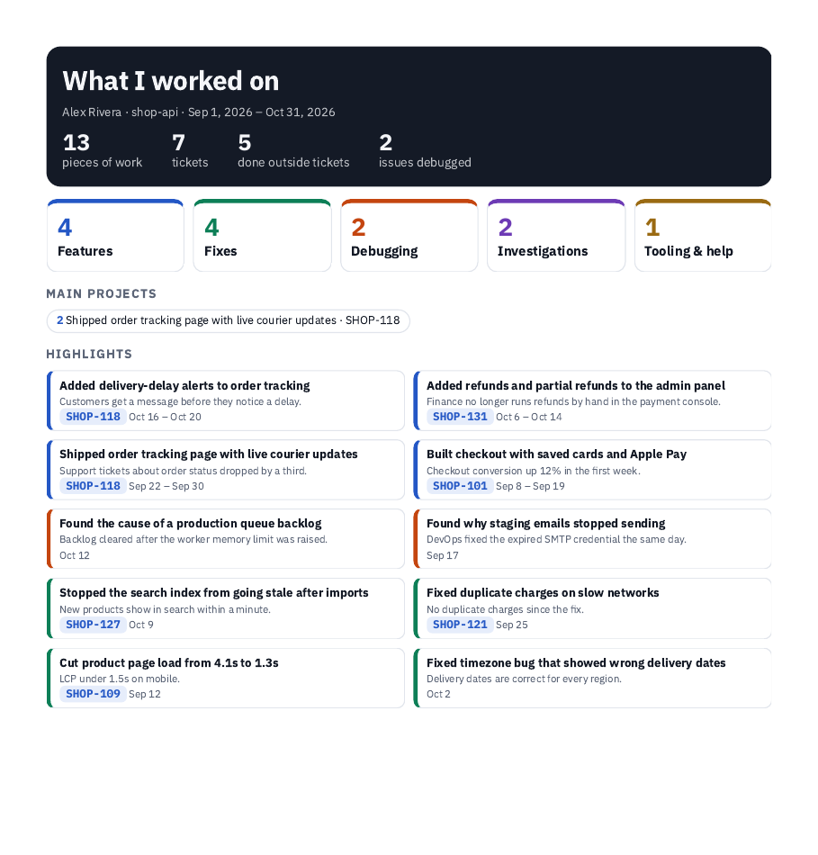

# worklog-recap

**Never forget what you worked on.**

A Claude Code plugin that builds your work log from two things you already have: your Claude Code chats and your own git commits. When your review, standup or probation check-in comes around, you get a 1-page summary instead of a blank page.



<sub>Sample data. Your report is built from your own chats and commits.</sub>

## Why

Big features are easy to remember. The rest is not: the production issue you debugged for another team, the report you wrote for your lead, the setup script that saved every new hire three days. That work never shows up in a ticket list, and it is exactly what gets forgotten when someone asks *"what have you done these past months?"*

worklog keeps track of it for you, while you work.

## Features

- **Backfills your history.** Scans your past Claude Code chats and your commits and turns them into log entries.
- **Logs as you go.** After each task, Claude adds an entry. A hook records each commit you make.
- **Only your work.** Commits are matched by your git email. Merges, rebases, conflict fixes and test data are left out.
- **Five categories.** Features, fixes, debugging (issues you found for other teams), investigations, and tooling and help.
- **Ticket aware.** Picks up ticket ids such as `ABC-123` and links them to your Jira site.
- **1-page PDF.** Totals, main projects and your top 10 highlights. Add `--full` for a one-line list of everything.
- **Interactive page.** Filter by category or project, search, and expand any item to see what you did, why, and the result.
- **Online page.** Publish the report as a private Claude artifact and share the link when you choose.
- **Per repo.** Each repository has its own log. Git worktrees share their repo's log.

## Requirements

- [Claude Code](https://claude.com/claude-code)
- Python 3.8 or newer (standard library only, nothing to install)
- Git 2.31 or newer
- Google Chrome, Chromium or Microsoft Edge for PDF export. Without one, the HTML page still works and has its own PDF buttons.

Tested on Linux. macOS paths for Chrome and Edge are supported. Windows is untested.

## Install

In Claude Code:

```
/plugin marketplace add burhanrepos/worklog-recap
/plugin install wlog@wlog
```

Restart Claude Code, open any git repository, and run:

```
/wlog:log setup
```

Setup takes about a minute. It reads your name and email from `git config`, finds your first commit, your GitHub remote and your Jira site (from your chats), then offers to scan your past chats and commits. It does not change any of your settings files: the hooks come with the plugin.

> worklog runs in **Claude Code** only. It reads your local Claude Code chat history and your git repository, which other Claude apps don't have.

## Usage

```
/wlog:log                        what you did in the last 2 weeks
/wlog:log list month             same, for a period
/wlog:log add <what you did>     log something by hand
/wlog:log scan                   find work in your chats and commits that is not logged yet
/wlog:log pdf                    1-page summary PDF + interactive page (all time)
/wlog:log pdf month              same, for the last 30 days
/wlog:log pdf --full             summary + one-line list of everything
/wlog:log artifact [period]      new online page with a new link
/wlog:log artifact update        refresh your last online page, same link
/wlog:log help                   show all commands
```

**Periods:** `week`, `month`, `quarter`, `year`, `all`, a month as `2026-10`, or exact dates as `2026-10-01 2026-10-31`.

You can also just ask in plain words:

> hide the lint fix from my work log
>
> log this: reviewed the payments PR with the new joiner
>
> what did I do in September?

Files are written to `~/Downloads`:

| File | What it is |
|---|---|
| `worklog-<repo>-<from>-to-<to>-summary.pdf` | 1-page summary for your lead |
| `worklog-<repo>-<from>-to-<to>.pdf` | Summary plus the full list (`--full`) |
| `worklog-<repo>.html` | Interactive page with search, filters and PDF buttons |

## What a log entry looks like

```json
{
  "date": "2026-10-12",
  "type": "debugging",
  "title": "Found the cause of a production queue backlog",
  "ticket": "",
  "what": "Read worker logs and queue metrics and found workers restarting on out-of-memory.",
  "why": "Order confirmation emails were delayed by up to an hour.",
  "outcome": "Backlog cleared after the worker memory limit was raised.",
  "evidence": ["queue metrics", "told the platform team"],
  "handed_to": "Platform team",
  "status": "done"
}
```

Types: `feature`, `fix`, `debugging`, `investigation`, `tooling`.

## Customising the report

Each repository has a config file at `~/.claude/worklog/<repo>/config.json`.

| Key | Purpose |
|---|---|
| `highlights` | Up to 10 entry ids to feature. Empty means chosen automatically, newest features first. |
| `projects` | Named project chips, for example `{ "ABC-123": "Checkout redesign" }`. Empty means every ticket with 2+ entries. |
| `hidden` | Entry ids left out of the report. The entries are kept, just not shown. |
| `name`, `email`, `since` | Who you are and how far back to import commits. |
| `jira`, `github` | Link targets for tickets and commits. |

Change the simple values with Claude (`set my jira site to https://acme.atlassian.net`) or directly:

```
python3 -I <plugin-folder>/skills/log/scripts/worklog.py set jira https://acme.atlassian.net/browse/
```

## What the plugin runs

Everything is in this repository as readable Python (standard library only). No packages are downloaded and nothing is sent over the network.

| When | What runs | What it does |
|---|---|---|
| A Claude Code session starts | `worklog.py session-context` (SessionStart hook) | If the current repo has a work log, adds a short instruction to Claude's context: log finished work with `worklog.py add`. In other repos it prints nothing. |
| After each Bash command | `worklog.py commit-hook` (PostToolUse hook) | Exits immediately unless the command was a `git commit` in a repo with a work log. Then it reads that commit's metadata with `git show` and appends it to `commits.jsonl`, only if the author email is yours. |
| When you ask for it | `/wlog:log` commands | Read your chats in `~/.claude/projects/` and your git history; write to `~/.claude/worklog/<repo>/` and `~/Downloads`. `pdf` runs your local Chrome, Chromium or Edge in headless mode to print the PDF. |

## Privacy

- Everything stays on your machine, in `~/.claude/worklog/<repo>/`. Nothing is sent anywhere.
- The only exception is `artifact`, which publishes the report as a **private** Claude artifact, and only when you run it. Only you can open it until you share it.
- Chat digests used for scanning mask common secrets (JWTs, bearer tokens, AWS keys, private keys) before Claude reads them.
- Entries are written to describe work, not data. The skill tells Claude never to include secrets, tokens, env values or customer data.
- Your chats only cover work done with Claude. Add meetings, reviews and console work by hand with `add`.

## Troubleshooting

| Problem | Fix |
|---|---|
| "No work log for this repo yet" | Run `/wlog:log setup` inside the repo. |
| Commits are not being recorded | Restart Claude Code after installing. Check that `git config user.email` matches the email on your commits. |
| No PDF, only HTML | Install Chrome, Chromium or Edge, or open the HTML file and use its PDF buttons. |
| Ticket chips are not links | Set your Jira site: `set jira https://<site>.atlassian.net/browse/`. |
| Wrong name on the report | `set name "Your Name"`. |

## Uninstall

```
/plugin uninstall wlog@wlog
```

The hooks go away with the plugin. Your data stays in `~/.claude/worklog/` until you delete it.

If you ever used the standalone skill version (copied into `~/.claude/skills/`), also remove its `## Work log (always on)` section from `~/.claude/CLAUDE.md` and its `worklog.py commit-hook` entry from `~/.claude/settings.json`.

## License

[MIT](LICENSE)
